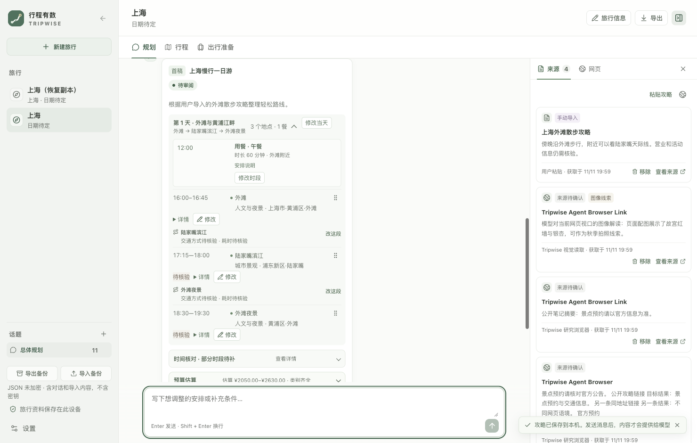
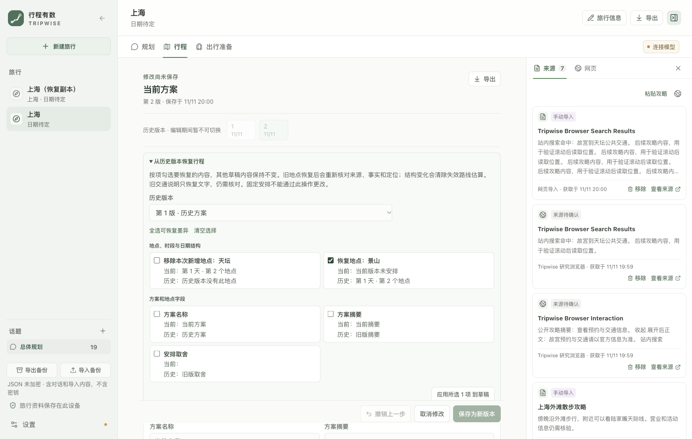

<p align="center">
  
</p>

<h1 align="center">行程有数 Tripwise</h1>

<p align="center">把攻略、地图、天气和对话整理成一份可持续修改的旅行计划。</p>

<p align="center">
  <a href="https://github.com/int2t05/Tripwise/actions/workflows/desktop.yml"></a>
  · <a href="https://github.com/int2t05/Tripwise/releases/latest">下载预览版</a>
  · <a href="LICENSE">MIT</a>
</p>

Tripwise 是一款开源桌面旅行规划 Agent。它在对话中了解出行条件，展示实际工具调用、资料来源和检查提示，生成一份结构化计划；用户可以逐项提出修改，确认后保存版本。

## 界面





截图使用隔离的模拟旅行资料，仅展示界面，不代表实时路线或旅行信息。

## 使用

### 下载

从 [GitHub Releases](https://github.com/int2t05/Tripwise/releases/latest) 下载 macOS、Windows 或 Linux 预览包，并用包内 `SHA256SUMS` 校验文件。

当前预览包尚未进行正式代码签名或公证，系统可能提示发行者未验证或阻止启动。需要稳定安装体验时，可先从源码运行。

### 配置模型

首次启动后打开「设置 → 连接与隐私」，填写兼容 OpenAI Chat Completions 的服务地址、模型名和密钥，保存并测试。地图、天气、搜索和 MCP 连接器按需添加；未配置的渠道会保留待核验提示。

### 规划与修改

1. 新建旅行，填写出发地、目的地、日期、抵离时间、预算、体力和偏好。
2. 在对话中补充行李、忌口、早起意愿、交通和住宿要求。
3. 查看 Agent 实际调用的工具、结果、来源和警告，再检查按日安排。
4. 用自然语言或计划中的编辑入口提出修改；每轮返回一份完整修订草案和差异。
5. 满意后保存为新版本。未确认的草案不会覆盖已保存计划。

## 开发

需要 Node.js `>=22.12.0` 和 npm。

```bash
git clone https://github.com/int2t05/Tripwise.git
cd Tripwise
npm ci
npm run dev
```

```bash
npm run check
npm run test:e2e:desktop
```

北京长流程会调用本机已保存的模型配置并联网检索；高德可使用本地 mock：

```bash
npm run evaluate:beijing:desktop-live -- --live --mock-map-services --skip-browser-smoke
```

评测用于检查计划结构和多轮修改，不代表真实路线或旅行事实已核实。脱敏记录见[北京评测](docs/evaluation/BEIJING-LIVE.md)。

## 数据与隐私

旅行资料保存在本机 JSON 文件中，未加密。服务密钥保存在本机 `tripwise-credentials.json`，同样未加密；POSIX 系统限制文件权限为 `0600`。发送对话时，旅行简报、消息和所选来源会发送给已配置的模型服务；连接器只接收完成查询所需的信息。不要把本机旅行资料、凭证文件或运行日志提交到公开仓库。更多边界见[技术架构](docs/design/TECH.md#5-安全边界)。

## 文档

- [产品需求](docs/PRD.md)
- [项目状态](docs/PROJECT-STATUS.md)
- [技术架构](docs/design/TECH.md)
- [UI/UX](docs/design/UIUX.md)
- [MCP 与渠道目录](docs/integrations/MCP-CATALOG.md)
- [开源渠道调研](docs/research/scraping-references.md)
- [北京评测摘要](docs/evaluation/BEIJING-LIVE.md)
- [变更记录](CHANGELOG.md)
- [贡献指南](CONTRIBUTING.md)

## 许可

项目代码使用 MIT License。第三方服务、模型、地图与数据来源仍受其各自条款约束，详见 [LICENSE](LICENSE)。
