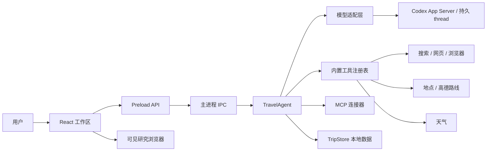
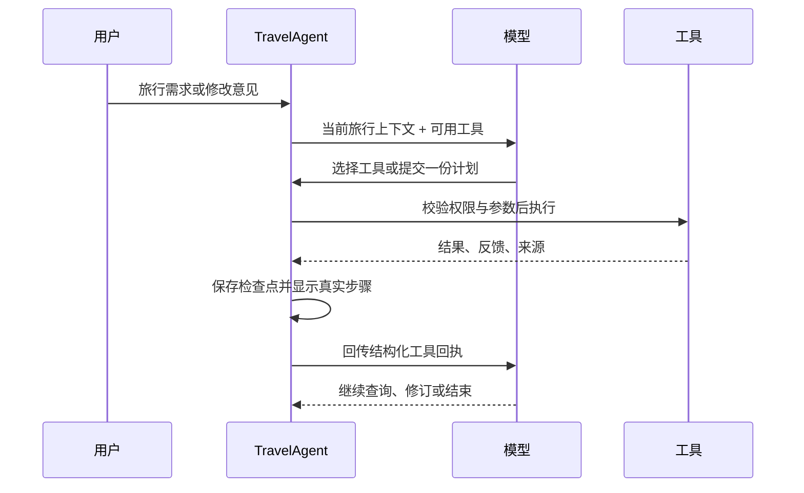

# Tripwise 技术架构

说明当前 Agent 主流程、边界和验证方式。产品规则见 [PRD](../PRD.md)，界面规则见 [UIUX](UIUX.md)，取舍见 [ADR](adr/0001-desktop-shell.md)。

**范围：** Electron 桌面端个人旅行规划；OpenAI-compatible API 或本机 Codex 登录；不预订、不支付。Codex 通过常驻 App Server 按话题保存会话，见 [ADR-0021](adr/0021-codex-app-server.md)。

## 1. 运行结构

- renderer 负责旅行工作区、计划和步骤显示；Preload 暴露类型化 IPC。旅行数据、凭证、工具执行和外部请求只由主进程管理。
- `src/main/agent.ts` 编排模型请求、工具调用、检查点、来源保存和结束状态。
- `src/main/connectors/` 实现单项工具；`src/main/tools.ts` 校验参数、执行工具并归一化失败反馈。
- 工具列表逐轮按用户意图和已提交候选过滤；详细计划的路线工具等地点顺序确定后才展示，具体路段仍由模型选择。
- `src/main/llm.ts` 适配 OpenAI-compatible Chat Completions 与 Codex App Server；`src/main/codex-app-server.ts` 管理 JSONL 子进程、线程索引、流式消息、权限隔离和话题清理。
- Codex 模式直接运行本机 CLI 的常驻 App Server，按话题恢复 thread，并通过 JSONL 双向协议接收流事件；不是 `codex exec` 单次进程或一次性 HTTP 回复。App Server 消息增量在主进程拼接并校验为 Tripwise 结构后才进入 Agent loop，界面只呈现真实状态和已校验的工具步骤，不渲染原始 JSON 或内部推理。
- Codex thread 与 Tripwise 话题一一对应。首轮写入当前旅行上下文；后续以新用户请求或 `toolOutput` 增量续写，不重复发送完整历史。模型回复仍按 Tripwise 结构化工具协议解析。
- Codex 登录与本机模型目录由 App Server 复用；Tripwise 不读取 Codex 认证文件。Codex thread 由 Codex 自己保存，Tripwise 仅在 userData 以 `0600` 索引话题 ID 与 thread ID。
- 启动时只读发现 Codex 用户 MCP 与已启用功能名，再逐项通过启动参数关闭；运行进程重新读取配置，确认 MCP 和功能均关闭后才允许模型 turn。Codex 内置工具不进入旅行工具循环。
- Codex thread 请求只读沙箱；该设置不代表 App Server 离线。Tripwise 不向模型暴露 Codex shell、文件、网页、浏览器或 computer-use 工具，模型服务连接仍需联网。
- Codex App Server 的长连接、断点恢复和退出清理决策见 [ADR-0021](adr/0021-codex-app-server.md)。当前北京真实模型运行数据见[实跑摘要](../evaluation/BEIJING-LIVE.md)。
- `src/main/persistence.ts` 保存旅行、对话、来源、草案和运行检查点；`src/renderer/src/AgentProgress.tsx` 展示实际工具步骤与结果。

## 2. Agent loop

- 模型读取用户意图并选择当前可用工具。Agent 不预先执行固定检索清单；工具回执返回后，再由模型判断下一步。
- 每个工具结果以 `{ status, proposal_saved, result, feedback, sources, proposal? }` 进入模型上下文并显示在步骤记录中。已保存的行程候选随回执返回，避免持久线程在增量续轮中丢失最新草案；已保存状态用 `proposal_saved: true` 明确说明。
- 已保存计划若带 `warning/info`，主循环追加一次可见复核状态和模型提示；最多 3 次。提示要求模型先判断用户明确要求和行程可行性，再决定是否用工具局部完善；不会自动调用工具，也不因剩余 warning 阻止交付。
- `error` 仅用于参数/结构无效、工具未获授权或结果无法安全保存；旅行内容质量不单独触发 error。`warning` 和 `info` 保留有效候选，由模型判断是否补查、修改或交付。
- 计划结构有效时，业务内容问题以 warning 回传，候选仍进入审阅；只在无法解析或无法安全应用某项局部修改时保留上一版，不伪装成已完成修改。
- 行程引用缺失或失败来源无法安全保存：来源与提案在同一工具回执中校验；候选不入库，`itinerary_source_invalid` 以 `error` 返回，让模型当轮移除引用或改用成功来源。这样可在最终消息落盘前修复，避免已完成的工具结果因末尾来源校验而整轮失败。
- 模型工具调用格式无效时，界面显示独立校验步骤并回传稳定错误码；格式恢复最多 3 次。工具 `error` 连续 3 次后结束当前工具循环，任一非 `error` 回执都会重置计数。
- 景点事实修订工具使用短 `quote_id`；仅在该工具开放时，附加按景点筛选的原文与编号对照，模型选择编号，工具恢复事实类别、来源和原文。
- 计划只输出一份。业务冲突、信息缺口、来源状态和自动规范化通过稳定 code 与简短反馈回传；除落实用户明确编辑外，工具不触发业务补查或整稿重排。
- 本轮成功路线未关联到候选通勤段时，提案工具回传 `route_source_not_bound` warning，附查询端点/方式/日期、未匹配原因和最多 3 个尚无估时的相邻停靠段；提示模型只按需补查关键路段，无关来源可忽略。模型自行判断修订或保留待核验，Agent 不自动补查。
- 详细计划若安排公共交通但没有关联路线估时，提案工具优先回传独立的 `requested_route_coverage_missing` warning，最多列 3 段示例；通用 `requested_detail_missing` 不再重复包含路线缺口，避免它被细节上限截断或重复展示。warning 允许模型选择性调用 `estimate_route`，也可保留待核验，不触发自动补查。路线绑定诊断日志仅记录安全计数和原因类别，不写地点、路线端点或请求文本。
- 用户要求具体餐馆且候选仍有占位餐次时，提案工具优先回传 `requested_named_meals_missing`，给出缺口数和最多 3 个例子，并指出 `propose_itinerary_meals`。来源不足时，有把握的商户品牌可作为待核验建议；不推断分店、地址或营业信息。未修改日期从餐次缺口反馈中排除，避免局部修改时重复报告旧餐次。该 warning 不触发自动修订。
- 工具结果先写入本地恢复检查点，再进入下一次模型请求。UI 显示真实开始、结果、状态和反馈，不显示模型思维链。
- 搜索额度、工具轮次和请求超时是防止无限运行的资源上限，不是计划质量分数。额度用尽后，模型使用已有资料并标注缺口；已经保存的草案不会因 warning 丢弃。
- 渠道额度或网络错误以 warning 回传；Agent 不在后台自动切换搜索、网页或浏览器工具。模型根据回执选择下一步，熔断仅限制对失效服务或主机的重复请求。

## 3. 工具与来源

- 内置工具覆盖网页搜索/阅读、隔离研究浏览器、地点、路线和天气。用户可选接入 MCP；只有当前连接且获准的只读工具会提供给模型。
- 所有工具经过主进程注册表和参数校验。写入、预约、支付、登录和外部内容发布不属于 Agent 能力。
- 搜索摘要用于发现资料；网页搜索和浏览器搜索结果分别以 `search_snippet_not_evidence`、`browser_search_page_not_evidence` warning 标记证据边界，由模型决定是否打开关键原文。事实依据保留来源链接、来源类型、状态和获取时间；没有可用直接依据时，结构化计划保留 `pending` 或待核验状态。
- 高德地点与路线工具只在对应服务启用时公开。模型按需调用 `estimate_route`；每次真实调用记录脱敏的追踪号、行程日、结果类别、选项数和耗时，不记录地点或请求参数。行程提案工具只在同日、相邻端点、方式和路线摘要匹配时绑定本轮路线来源；未匹配时回传带原因与下一步选择的 warning，由模型决定是否调整或重查。系统不预扫描行程或自动补查路线。估时不等同实时班次或路况。
- 小红书 OpenCLI 默认关闭；公开网页和用户提供的内容可作为社区来源。遇登录、验证码或访问门槛时停止自动读取，由用户决定接管方式，不绕过限制。

## 4. 失败与恢复

| 情况 | 行为 |
|---|---|
| 参数或结构错误 | 以 `error` 回传；未通过结构校验的计划不保存。 |
| 来源缺失或服务部分失败 | 以 `warning` 回传；保留成功来源，模型决定是否换工具或继续交付。 |
| 内容与业务差异 | 以 `warning` 回传；有效结构的候选保留，模型判断是否修改。 |
| 用户跳过外部查询 | 以 `info` 说明；模型使用现有资料，动态事实标为待核验。 |
| 运行中断 | 已落盘的来源和工具结果留在检查点；恢复时复用已完成结果，未保存的调用可能重跑。 |
| 用户停止 | 停止后续模型/工具调用，保留已完成结果。 |
| 模型不可用、额度耗尽或超时 | 保留用户输入、来源与已完成工具回执；显示错误原因和恢复入口，可重试原消息或缩小任务。额度耗尽不会自动循环重试。 |

## 5. 安全边界

- 模型和连接器数据按不可信输入处理；工具执行层复核当前工具白名单、目的地和用户授权。
- 网页浏览使用隔离 WebView，不读取系统浏览器登录态、不操作系统光标、不执行页面脚本或任意坐标点击。
- 凭证保存在本机 `tripwise-credentials.json`，采用文件权限保护；同一 macOS 账户下的其他程序仍可能读取。凭证不写入日志、旅行备份或 renderer 快照。
- 日志记录阶段、工具名、耗时、结果数量和错误分类，不记录 API Key、完整对话、工具参数或网页正文。
- Codex App Server 使用本机已登录账户并将 thread 保存在 Codex 自己的数据目录；删除 Tripwise 话题时同步请求删除该 thread。配置损坏或无法证明工具隔离时拒绝发送模型请求。

## 6. 验证

- `npm run typecheck`：主进程、renderer、preload 类型检查。
- `npm test`：Vitest 与 Node 回归。
- `npm run check`：类型检查、完整测试和生产构建。
- `npm run test:e2e:desktop`：桌面关键路径验收。
- `npm run evaluate:beijing:desktop-live -- --live --mock-map-services`：配置模型下的北京长任务验收；地图结果为 mock，不能证明真实路线。
- 真实服务运行与结构/内容结果见[北京实跑摘要](../evaluation/BEIJING-LIVE.md)和[项目状态](../PROJECT-STATUS.md)；自动化通过不替代供应商许可或目标设备验收。
